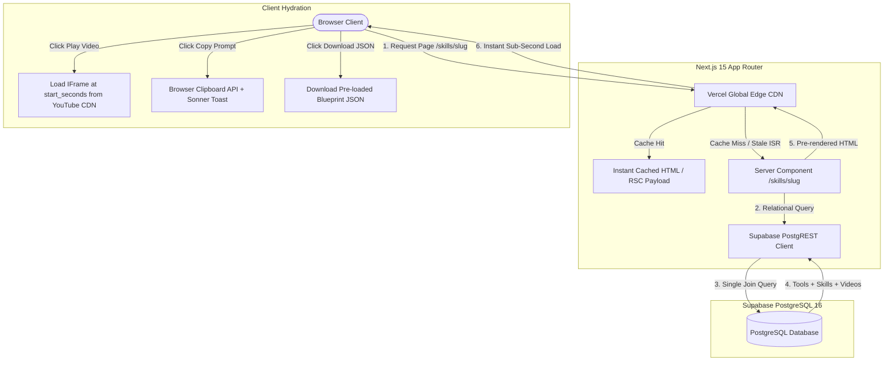

# Technical Architecture Spec (SPEC): SnapStack (V1 MVP)

* **Product Name:** **SnapStack** (Working Title)
* **Document ID:** `SPEC-MVP-001`
* **Related PRD:** `PRD-MVP-001`
* **Status:** Approved for Implementation
* **Framework:** Next.js 15 (App Router, TypeScript) + Supabase (PostgreSQL)

---

## 1. System Architecture & Request Lifecycle

The application leverages **Next.js 15 React Server Components (RSC)** with **Incremental Static Regeneration (ISR)** to achieve instant global response times while keeping hosting costs at **$0/month**.

### Data Flow Diagram (Mermaid)



---

## 2. Technical Decisions & Evaluated Alternatives (ADR)

| Architectural Decision | Chosen Strategy | Alternatives Evaluated | Rationale & Trade-Off |
| :--- | :--- | :--- | :--- |
| **Framework** | **Next.js 15 App Router (RSC)** | Astro, Remix / React Router v7 | Next.js 15 provides native ISR caching, superior Vercel edge deployment, and automatic OpenGraph image generation (`next/og`). |
| **Database & Auth** | **Supabase (PostgreSQL 16)** | Firebase Firestore, MongoDB, Neon | Connected data (Tools $\leftrightarrow$ Skills $\leftrightarrow$ Videos) requires clean relational joins. Firestore makes many-to-many lookups slow and denormalized. |
| **Video Playback** | **Lite Facade Component** | Native YouTube Iframes, Self-hosted MP4s | Storing video files costs thousands in bandwidth. Raw YouTube iframes pull ~500KB of tracking scripts per video. The Lite Facade loads pure image thumbnails until clicked, guaranteeing a 98+ Lighthouse score. |
| **CSS & Components** | **Tailwind CSS v4 + shadcn/ui** | Material UI, Chakra UI, Vanilla CSS | shadcn/ui primitives are copied directly into the project; zero bloated runtime JS packages, 100% accessible via Radix primitives. |

---

## 3. Relational Database Schema & Foreign Key Indexing

To prevent sequential scans and optimize query speed, all foreign key relationships feature explicit B-tree indexes and cascading deletes.

```sql
-- 1. Tools Table (Core Software Products)
CREATE TABLE public.tools (
  id UUID PRIMARY KEY DEFAULT gen_random_uuid(),
  name TEXT NOT NULL,
  slug TEXT UNIQUE NOT NULL,
  website_url TEXT NOT NULL,
  category TEXT NOT NULL,
  tagline TEXT NOT NULL,
  pricing_model TEXT NOT NULL CHECK (pricing_model IN ('free', 'freemium', 'paid', 'open-source')),
  starting_price NUMERIC DEFAULT 0,
  free_tier_limits TEXT,
  soc2_compliant BOOLEAN DEFAULT false,
  gdpr_compliant BOOLEAN DEFAULT false,
  trains_on_user_data BOOLEAN DEFAULT false,
  verified_status TEXT DEFAULT 'verified' CHECK (verified_status IN ('verified', 'pending', 'deprecated')),
  created_at TIMESTAMPTZ DEFAULT timezone('utc'::text, now()) NOT NULL
);

-- 2. Skills Table (Jobs-to-be-Done & Workflows)
CREATE TABLE public.skills (
  id UUID PRIMARY KEY DEFAULT gen_random_uuid(),
  title TEXT NOT NULL,
  slug TEXT UNIQUE NOT NULL,
  job_to_be_done TEXT NOT NULL,
  role_category TEXT NOT NULL, -- 'founders', 'sales', 'marketing', 'operations', 'developers'
  difficulty TEXT NOT NULL CHECK (difficulty IN ('no-code', 'low-code', 'developer')),
  platform TEXT NOT NULL, -- 'make', 'n8n', 'zapier', 'prompt-only', 'python'
  time_saved_estimate TEXT NOT NULL,
  free_alternative_available BOOLEAN DEFAULT true,
  free_alternative_prompt TEXT,
  free_alternative_notes TEXT,
  system_prompt TEXT NOT NULL,
  blueprint_json JSONB,
  step_by_step_sop JSONB NOT NULL,
  failure_modes TEXT,
  verified_model TEXT DEFAULT 'Claude 3.7 / GPT-4o',
  verified_date DATE DEFAULT CURRENT_DATE,
  view_count INTEGER DEFAULT 0,
  upvotes INTEGER DEFAULT 0,
  created_at TIMESTAMPTZ DEFAULT timezone('utc'::text, now()) NOT NULL
);

-- 3. Videos Table (YouTube Walkthroughs & Shorts)
CREATE TABLE public.videos (
  id UUID PRIMARY KEY DEFAULT gen_random_uuid(),
  youtube_video_id TEXT NOT NULL UNIQUE,
  title TEXT NOT NULL,
  channel_title TEXT NOT NULL,
  channel_url TEXT,
  duration_seconds INTEGER NOT NULL,
  video_type TEXT NOT NULL CHECK (video_type IN ('short', 'full_tutorial')),
  start_seconds INTEGER DEFAULT 0,
  curated_notes TEXT,
  verified_status TEXT DEFAULT 'verified',
  created_at TIMESTAMPTZ DEFAULT timezone('utc'::text, now()) NOT NULL
);

-- 4. Junction Tables (Many-to-Many Relationships)
CREATE TABLE public.tool_skills (
  tool_id UUID REFERENCES public.tools(id) ON DELETE CASCADE,
  skill_id UUID REFERENCES public.skills(id) ON DELETE CASCADE,
  PRIMARY KEY (tool_id, skill_id)
);

CREATE TABLE public.video_tools (
  video_id UUID REFERENCES public.videos(id) ON DELETE CASCADE,
  tool_id UUID REFERENCES public.tools(id) ON DELETE CASCADE,
  PRIMARY KEY (video_id, tool_id)
);

CREATE TABLE public.video_skills (
  video_id UUID REFERENCES public.videos(id) ON DELETE CASCADE,
  skill_id UUID REFERENCES public.skills(id) ON DELETE CASCADE,
  PRIMARY KEY (video_id, skill_id)
);

-- 5. Foreign Key & Query Performance Indexes
CREATE INDEX idx_tool_skills_skill ON public.tool_skills(skill_id);
CREATE INDEX idx_tool_skills_tool ON public.tool_skills(tool_id);
CREATE INDEX idx_video_skills_skill ON public.video_skills(skill_id);
CREATE INDEX idx_video_tools_tool ON public.video_tools(tool_id);
CREATE INDEX idx_skills_role ON public.skills(role_category);
CREATE INDEX idx_skills_slug ON public.skills(slug);
CREATE INDEX idx_tools_slug ON public.tools(slug);

-- 6. Enable Row-Level Security (RLS)
ALTER TABLE public.tools ENABLE ROW LEVEL SECURITY;
ALTER TABLE public.skills ENABLE ROW LEVEL SECURITY;
ALTER TABLE public.videos ENABLE ROW LEVEL SECURITY;
ALTER TABLE public.tool_skills ENABLE ROW LEVEL SECURITY;
ALTER TABLE public.video_tools ENABLE ROW LEVEL SECURITY;
ALTER TABLE public.video_skills ENABLE ROW LEVEL SECURITY;

-- 7. Public Read Access Policies (Anonymous + Authenticated)
CREATE POLICY "Public read tools" ON public.tools FOR SELECT USING (true);
CREATE POLICY "Public read skills" ON public.skills FOR SELECT USING (true);
CREATE POLICY "Public read videos" ON public.videos FOR SELECT USING (true);
CREATE POLICY "Public read tool_skills" ON public.tool_skills FOR SELECT USING (true);
CREATE POLICY "Public read video_tools" ON public.video_tools FOR SELECT USING (true);
CREATE POLICY "Public read video_skills" ON public.video_skills FOR SELECT USING (true);
```

---

## 4. Edge Cases, Failure Modes & Security

1. **YouTube Video Removal / Embedding Disabled:**
   * *Mitigation:* The Lite Facade intercepts playback errors. If a YouTube video is deleted or marked private, the UI falls back to displaying a friendly badge: *"Video currently unavailable; follow the written SOP and prompt below."*
2. **Missing Blueprint JSON:**
   * *Mitigation:* If a workflow does not require an automation file (e.g. Prompt-Only workflows), the download button gracefully hides and highlights the System Prompt card instead.
3. **Database Unavailability / Cold Start:**
   * *Mitigation:* Next.js static pages are pre-rendered at build time with ISR (`revalidate = 3600`). Even if Supabase experiences maintenance downtime, visitors will still receive instant cached HTML from the Vercel edge CDN.
4. **Clipboard Permissions in Mobile Browsers:**
   * *Mitigation:* The `copyToClipboard` helper falls back to `document.execCommand('copy')` if the modern `navigator.clipboard` API is restricted in webviews.

